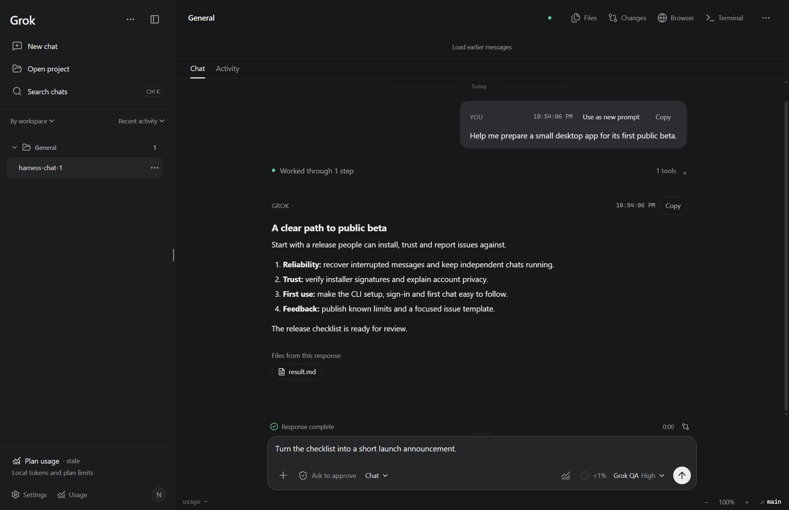

# Grok Desktop Community

[](https://github.com/goodcantor/grok-desktop-community/actions/workflows/ci.yml)

An independent, open-source desktop client for the official **Grok Build CLI**. Chat right away, then open a project when you need files, Git, terminals or a browser.

**Experimental community beta · 0.1.0-beta.1.** Check Releases for current download availability. The first preview has no verified publisher signature: Windows is unsigned and macOS is ad-hoc signed without Apple notarization. Updates are manual. This is an independent community project, not an official xAI desktop product.



## Why Community?

- Independent chats keep working while you switch; each has its own queue, approvals and recovery.
- Plain Chat, native Plan and Goal flows, custom answers and inline permission cards.
- Search your shared native conversation history, keep drafts, pin and organize chats.
- Read a concise response or inspect tool activity, reasoning and confirmed file results.
- Use Files, Git Changes, a native terminal and a retained browser page for each chat.
- English interface, light/dark themes, keyboard shortcuts and accessible layouts at high zoom.

Screenshots use demo data in the real application. [Light theme](docs/screenshots/community-light.png) · [Inline questions](docs/screenshots/community-questions.png) · [Parallel tasks](docs/screenshots/community-parallel.png) · [Activity](docs/screenshots/community-activity.png) · [Browser](docs/screenshots/community-browser.png). No personal conversations or credentials are included.

## Download and install

Use only [Community GitHub Releases](https://github.com/goodcantor/grok-desktop-community/releases). Preview files become downloadable after native checks and owner review; a draft is not a public download. Choose an installer, not GitHub's automatic “Source code” archive.

| Target | Preview file | Baseline / signature |
| --- | --- | --- |
| Windows x64 | `…Windows-x64-Unsigned-Setup.exe` | Windows 11 · unsigned |
| macOS Apple Silicon | `…macOS-arm64-Unnotarized.dmg` | macOS 14+ · ad-hoc, not notarized |
| macOS Intel | `…macOS-x64-Unnotarized.dmg` | macOS 14+ · ad-hoc, not notarized |
| Ubuntu x64 | `…Linux-x64.deb` | Ubuntu 24.04 · direct package |
| Linux x64 alternative | `…Linux-x64.AppImage` | AppImage runtime/FUSE or extraction required |

1. Install the official [Grok Build CLI](https://docs.x.ai/build/overview). Community does not bundle the agent, models or model access. The `grok` command must be available before a chat connects.
2. Download your installer and `SHA256SUMS.txt` from the same release. Compare the selected file's SHA-256 before running it. A matching checksum proves file integrity, not publisher identity or malware safety. GitHub build-provenance attestations provide a separate source/build-origin check.
3. Install using the platform instructions below, then open **Grok Desktop Community**. Your existing Custom installation remains separate.
4. Sign in through the official CLI flow, or use an existing native login. Access and billing follow your Grok account or API configuration; the MIT GUI license does not provide model access.
5. Start chatting. Open a project when you need workspace tools.

Current official Windows interoperability was checked with Grok Build 1.0.62, including a real response. macOS/Linux preview checks use synthetic native homes and an unavailable CLI; complete real-CLI acceptance there remains pending. New engine versions require capability checks rather than assuming every TUI feature has a Desktop API.

### Verify your download

Windows PowerShell (compare the returned hash with the exact filename in `SHA256SUMS.txt`):

```powershell
Get-FileHash .\GrokDesktopCommunity-0.1.0-beta.1-Windows-x64-Unsigned-Setup.exe -Algorithm SHA256
```

macOS Terminal:

```sh
shasum -a 256 GrokDesktopCommunity-0.1.0-beta.1-macOS-arm64-Unnotarized.dmg
```

Use the x64 filename on Intel Macs. On Linux use `sha256sum` for the downloaded DEB or AppImage. Do not install a file if its hash differs. To inspect provenance with the official GitHub CLI: `gh attestation verify <downloaded-file> --repo goodcantor/grok-desktop-community`.

### Windows first launch

Run the Setup executable. It installs Community separately from Custom and does not replace shared native history. Windows may display “Unknown publisher” or SmartScreen. If you choose to trust this experimental build after checking its source and checksum, the per-file **More info → Run anyway** choice may be available. Smart App Control and managed-device policies can block it entirely; do not disable those protections to install this preview. A malware detection is a reason to stop and report the file, not a normal installation step.

### macOS first launch

Open the DMG, drag **Grok Desktop Community.app** into Applications, eject the image and launch the copied app. These preview apps have an ad-hoc integrity signature, not a verified Developer ID, and have not been notarized by Apple. After the initial blocked launch, macOS may offer **System Settings → Privacy & Security → Open Anyway** for this app if you choose to trust it. See [Apple's first-launch guidance](https://support.apple.com/en-us/102445). If it is reported damaged, revoked or malicious, stop and check/report the download. Community does not ask you to disable Gatekeeper or clear quarantine in Terminal.

### Linux installation

On Ubuntu 24.04, install the downloaded DEB with the system package manager:

```sh
sudo apt install ./GrokDesktopCommunity-0.1.0-beta.1-Linux-x64.deb
```

Then launch Community from the application menu. The AppImage is an alternative: make that file executable in its Properties and launch it. FUSE/AppArmor policies can affect AppImage startup on some distributions; use the tested Ubuntu DEB path when available. Do not pass `--no-sandbox` or disable system protections to resolve startup errors. Isolated tool terminals require a working bubblewrap backend; interactive user terminals use host access.

### Uninstall

Windows: Settings → Apps → Installed apps → Grok Desktop Community → Uninstall. macOS: quit Community and move its application to Trash. Ubuntu: `sudo apt remove grok-desktop-community`; for AppImage delete the downloaded file. These operations do not require deleting `~/.grok`. Keep shared native history/authentication, and export needed unsent drafts before manually removing Community UI data.

## Safety and data

Native authentication, skills, MCP and conversations remain in `GROK_HOME` (normally `~/.grok`). Community has its own UI preferences; it does not import settings from Custom or upstream Desktop. See [Privacy](PRIVACY.md).

Tool approvals, file path restrictions and terminal isolation are separate controls. **When isolation is enabled but unavailable, tool terminals are blocked.** Explicit host shell mode runs with your user account privileges; a project working directory is not a filesystem jail. Interactive terminals are user-operated host shells. The CLI process and configured MCP servers are outside the Desktop tool-terminal jail.

Community never changes coding-data sharing on startup. Inspect or change that account setting using `/privacy` in the official CLI. Preview denies sensitive site permissions by default; websites receive no application bridge.

Saved queues restore paused. Interrupted delivery is shown for review and is never replayed automatically. Check native history before retrying a message whose delivery is uncertain.

## Updates

**Unsigned previews use manual updates.** Help → Check for updates and Settings → Updates point to Community Releases. The preview does not download or install updates in-app and publishes no updater metadata. Finish or stop active chats, save file edits, close Community, verify the next installer and install it over Community. Preferences and native history are retained; recovered queues remain paused.

A future signed distribution uses only `goodcantor/grok-desktop-community`, with confirmed download/installation and active-task/file-edit guards. Stable and beta channels remain separate. The signed release workflow never falls back to unsigned output. [Distribution choices without a budget](docs/DISTRIBUTION.md).

## Troubleshooting

- **CLI missing:** install it from the official guide, then use Refresh or restart Community. Community does not change your global `grok` command.
- **Sign-in failed:** retry the official browser/device flow. Never include auth.json, API keys or login URLs in an issue.
- **Terminal isolation unavailable:** configure the reported backend, or explicitly choose host access in Settings after reviewing its privileges. Chat remains available.
- **History missing:** confirm both clients use the same `GROK_HOME`. The search index is disposable; native conversations are authoritative.
- **Update unavailable:** check the Releases page. A missing release, network error or signature failure must not install anything.

Report bugs using the [issue form](https://github.com/goodcantor/grok-desktop-community/issues/new/choose). Security reports belong in [private vulnerability reporting](https://github.com/goodcantor/grok-desktop-community/security/advisories/new), not public issues. There is no promise of a response SLA during beta.

## Build from source

Use Node 22.19+ and the native operating system for the target package:

```sh
npm ci
npm run typecheck
npm test
npm run build
npm run test:native
# Windows: native screenshots, high zoom, task states and scrolling
npm run test:ui
npm run pack -- --publish never
```

Development packages may be unsigned and are not public release assets. The signed release workflow requires verified Windows/Apple signing. The separate preview workflow prepares explicitly unsigned/ad-hoc draft prereleases, with installed-payload checks, SHA-256, SBOM and provenance; publication needs a maintainer decision. It never claims signed or stable status. [Developer guide](docs/DEVELOPMENT.md) · [Release process](AGENTS.md) · [Roadmap](ROADMAP.md).

## License and credits

MIT, retaining [Karman de Lange / liaan's Grok Desktop](https://github.com/liaan/grok-desktop) copyright. Community is based on upstream v1.4.7, with the personal Custom improvements adapted for public distribution. Grok Build is installed separately under its own upstream terms. DeepSeek Harness informed compatible interface flows; its agent runtime is not bundled. See [Third-party notices](THIRD_PARTY_NOTICES.md) and [historical Custom notes](docs/CUSTOM-HISTORY.md).
